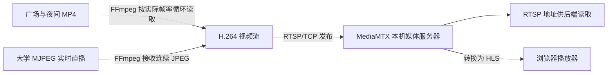

# 真实直播与模拟摄像头

这套资源为项目提供三路标准 RTSP 输入。广场和夜间画面是循环播放的录像；傅科摆来自海德堡大学公开实时摄像头。模拟输入不是推理结果，不会生成虚构的检测或报警。

## 已准备的资源

| 名称 | 类型 | RTSP 地址 | 浏览器播放 |
|---|---|---|---|
| 行人广场 | MOT17-02 示例录像循环，20 秒 | `rtsp://127.0.0.1:8554/plaza` | http://127.0.0.1:8888/plaza/ |
| 夜间街道 | MOT17-04 示例录像循环 | `rtsp://127.0.0.1:8554/night` | http://127.0.0.1:8888/night/ |
| 大学傅科摆 | 真实 MJPEG 直播，依赖互联网 | `rtsp://127.0.0.1:8554/pendulum` | http://127.0.0.1:8888/pendulum/ |

直播官网：https://kip.uni-heidelberg.de/oeffwiss/pendelcam/  
原始直播直链：https://kip.uni-heidelberg.de/mjpg/video.mjpg  
录像来源：https://motchallenge.net/data/MOT17/  
媒体服务器：https://github.com/bluenviron/mediamtx/releases/tag/v1.21.2

原始直播为不断发送 JPEG 图像的 MJPEG，不是 RTSP。FFmpeg 将它转成 H.264 后发布到本机 RTSP。公网直播可能断线；本机两路录像下载完成后可离线使用。素材使用范围以来源方条款为准。

## 启动与停止

1. 先按主 README 安装依赖并启动项目 `start.cmd`。
2. 双击 `start-camera-lab.cmd`。首次下载并校验 MediaMTX 与录像；后续复用校验通过的本地文件。
3. 打开上述浏览器播放链接。摄像头地址同时通过项目 API 登记，不会每次启动重复创建。
4. 在摄像头启动窗口按 Ctrl+C，会停止本次启动的媒体服务器和推流进程，项目本身继续运行。

离线只启动两段录像：

```powershell
.\start-camera-lab.cmd --offline
```

只准备下载、不启动服务：

```powershell
.\.venv\Scripts\python.exe deploy/scripts/simulated_cameras.py --prepare-only
```

媒体进程和日志位于 `var/camera-lab/`；录像、二进制与运行数据不提交 Git。RTSP 8554、HLS 8888 和控制 API 9997 均仅监听 127.0.0.1。端口占用时明确退出，不关闭其他进程，也不修改防火墙。

## 代码如何工作



- `deploy/camera-resources.json` 固定下载地址、大小、SHA-256、资源名称及实时/录像来源。
- `verified_download()` 校验缓存；下载到 `.part`，大小及哈希正确后才替换目标文件，失败清理半成品。
- `prepare()` 只从官方压缩包提取指定的服务器程序和许可证，复用现有 FFmpeg，不安装系统服务。
- `media_config()` 只允许三个已知发布路径，通过本机端口提供视频；关闭不需要的 RTMP、SRT 和 WebRTC。
- `publisher_command()` 构造 FFmpeg 参数。录像使用 `-re` 限制读取速度、`-stream_loop -1` 无限循环；实时摄像头不使用录像循环。
- 所有输入统一编码为 H.264、yuv420p、15 FPS、定期关键帧，再经 `-f rtsp -rtsp_transport tcp` 发布。示例录像原编码是 MPEG-4，因此不能简单复制编码后保证浏览器可播放。实时 MJPEG 使用实际接收时间戳；源刷新较慢时会重复最近帧，输出 15 FPS 不代表摄像头本身每秒产生 15 张不同画面。
- `register_sources()` 调用已有 `/api/v1/sources`，按 RTSP 地址查找已有记录后再创建，不裸写数据库，也不改动已有视频源。
- `main()` 启动一个 MediaMTX 和各路 FFmpeg；单路发布退出时重试；Ctrl+C 清理本次子进程。

录像推流的核心命令相当于：

```powershell
ffmpeg -re -stream_loop -1 -i plaza.mp4 -an -vf "scale=960:-2,fps=15" -c:v libx264 -preset ultrafast -tune zerolatency -pix_fmt yuv420p -g 30 -f rtsp -rtsp_transport tcp rtsp://127.0.0.1:8554/plaza
```

MediaMTX 必须先启动；FFmpeg 是发布端，不是 RTSP 服务器。HLS 播放有分片缓冲，画面会比输入晚几秒。

## 与当前工作台的边界

项目的视频源管理登记这些 RTSP 地址后，可在 8000 端口页面直接点击“打开预览”。后端确认本机 MediaMTX 的对应路径已就绪，返回同源 HLS 地址；清单和分片均经项目 API 转发，前端优先使用浏览器原生 HLS，否则懒加载 hls.js。切源、重试和离开页面会释放播放器资源。8888 端口独立播放器仍可用于排查。

适配器位于 `backend/app/shared/media_gateway.py`。它只读取已经发布到本机网关的流，不自动配置任意外部摄像头，也不向浏览器泄露上游凭据。实体摄像头应先在 MediaMTX 发布，再在项目中登记网关 RTSP 地址。源归档、网段变化、非法清单或跨源重定向均会阻止播放。

运行状态与系统诊断查询实际网关状态。连接测试会区分 RTSP 可达与网关已就绪；仅连接成功不会伪报实际解码成功或把“未验证”状态直接改成“在线”。

## 验证

```powershell
.\.venv\Scripts\python.exe -m unittest discover -s tests/deploy -v
```

验证包含录像循环/实时输入区分、TCP 发布参数、本机监听限制、路径检查、重复登记和下载校验。运行后还应通过真实 FFmpeg 解码每路视频，确认 HLS 清单与网页播放，不以 RTSP DESCRIBE 成功替代实际画面验证。

2026-10-22 本机验证：10 项部署测试通过；三路均成功解码实际视频帧、HLS 清单均返回 200；真实直播与广场循环已在浏览器实际播放。媒体进程只有 127.0.0.1:8554、8888、9997 三个 TCP 监听。项目中登记三条视频源，重复启动未增加重复记录。

## 摄像头状态验证

点击“测试连接”后，Worker 先检查 RTSP 会话和网关发布状态，再通过本机 FFprobe 实际读取最多 45 个视频包并解码（等待关键帧，总时长仍受连接超时限制）；只有读取到视频帧才显示“在线”，并保存分辨率、帧率和最近检测时间。仅 RTSP 会话可达但未接入网关时仍显示“未验证”。

已验证的摄像头每 30 秒进入一次复检队列，受现有并发数和作业租约控制；断流显示“已断开”，恢复并重新成功解码后显示“在线”。这是周期性状态采样，不能表示两次采样之间始终在线。归档的摄像头不复检。

验证：后端全量 89 项测试通过；本机 pendulum 实际解码返回 960×540、15 fps。
