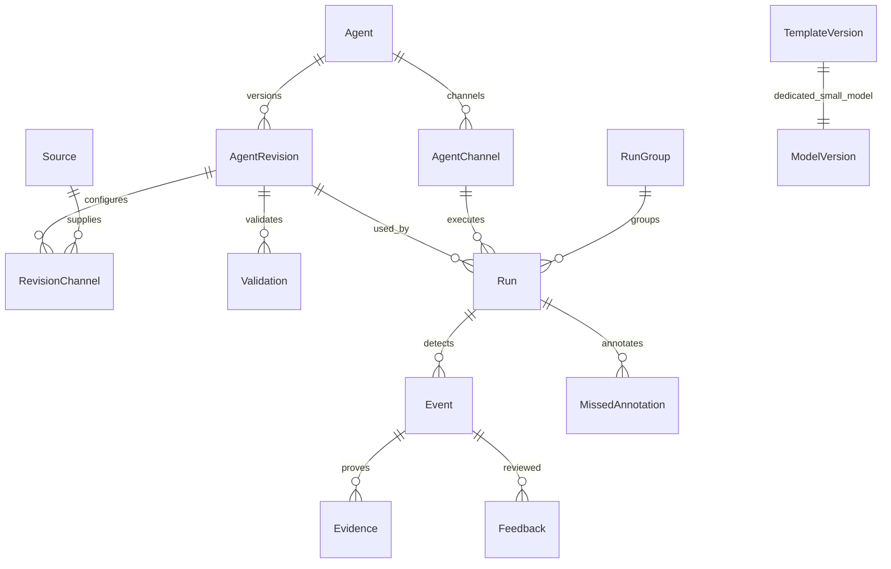

> 2026-10-19 用户需求更新：应用本身不设置账号、登录或角色权限，打开即用；不是本机登录绕过，也没有可选账号模式。本文原版中的管理员、登录、Cookie 会话和相关验收条目已被此决定取代，摄像头自身认证不受影响。当前接口以 FOUNDATION_API.md v1.1 为准。

> 2026-10-22 最新结构：智能体代表业务，通道代表共享规则的监测组，每组可绑定多个视频源、按源配置区域和录像范围；详见 [通道与多视频操作说明](AGENTS_SOURCE_GROUPS.md)。该规则覆盖下文原单源通道的描述。


# 开放场景视觉监测现场快速验证软件

# AI 开发主规格说明书

- 版本：1.0
- 日期：2026-10-18（Asia/Shanghai）
- 交付：独立 Markdown 主文件，可直接交给开发 AI。
- 产品形态：本地部署 Web 应用，浏览器访问本机或受控局域网服务。
- 读者：开发 AI、技术负责人、新人 A、新人 B、算法与测试人员。
- **必须**：产品或验收约束；**建议默认**：未被用户确认但可据此推进的设计；**待决**：不可伪装为已确认的事项。

## 0. 来源、效力与阅读方法

### 0.1 已读取资料

1. 用户本次请求和明确列出的已确认决策。
2. 原始《功能需求分析.md》：已在本地找到并完整读取，包含 FR-03 至 FR-32、六类候选场景，以及云端 Demo 必须转为本地能力的说明。原文件没有 FR-01、FR-02，不补造其含义。
3. 历史会话“推荐简洁UI设计”（ID：6ad065ee-9bb4-83ee-bbbe-6eba05c27566）：可读消息确认卡片式智能体管理替代任务管理、运行中查看视频和报警并编辑、模块解耦并共用基础设施。部分助手回答仅返回内容引用，不据此推断更多承诺。

本文件已吸收原文件全部可读需求，开发 AI 不需要访问原附件。效力次序：用户本次明确决策 > 原需求确认项 > 可读历史确认 > 本文建议默认。冲突必须记录，不静默改变需求。

阅读顺序：第 1–5 节理解产品与页面；第 6–10 节实现业务闭环；第 11–16 节实现数据、契约与基础设施；第 17–20 节完成部署和验收。不能只据导航名称生成展示空壳。

### 0.2 决策台账

| ID | 状态 | 决策 |
|---|---|---|
| C01 | 已确认 | 七个一级导航固定：快速监控看板、运行状态、视频源管理、任务创建、智能体管理、模型管理、系统设置 |
| C02 | 已确认 | 智能体管理替代旧任务管理；卡片点开可看实况、报警、历史、配置并编辑 |
| C03 | 已确认 | Coze/Dify 风格 A：浅色极简工作台，专业视频任务编辑 |
| C04 | 已确认 | 运行中编辑仅形成新草稿，验证确认后应用；历史运行继续绑定旧版本 |
| C05 | 已确认 | 新人 A 负责任务创建和模型管理，新人 B 负责智能体管理；模块化单体后端解耦、公用契约和基础设施 |
| C06 | 已确认 | Vue3 + TypeScript + Vite + Naive UI + Pinia + Vue Router + Axios |
| C07 | 已确认 | FastAPI + SQLAlchemy + Alembic + SQLite、WebSocket、MediaMTX + FFmpeg、Python 独立 Worker |
| C08 | 已确认 | 本地小模型与模板一一对应，预部署本地语言/多模态模型，不依赖云服务 |
| C09 | 已确认 | FR-03–32 全部保留，包括反馈、漏报、复测、报告和证据导出、多路独立控制 |
| D01 | 建议默认 | 一个智能体是一份可复用监测定义，可含多路独立配置；每一路每次启动产生独立 Run |
| D02 | 建议默认 | 应用新版本采用先停受影响旧运行、再以新版本创建新运行；首版不做帧内热切换 |
| D03 | 建议默认 | SQLite 持久作业队列和租约，不引入 Redis/Celery；媒体放受控本地目录 |
| D04 | 建议默认 | WebRTC 优先，HLS 兼容回退；WS 传状态和事件，不传视频帧 |
| D05 | 建议默认 | 报告先提供离线 HTML、JSON/CSV；PDF 使用本地渲染器，是否强制首版提供待决 |
| D06 | 建议默认 | 本地管理员、操作员、只读三角色；默认回环监听，局域网启用认证与 HTTPS |

## 1. 产品目标、非目标与领域术语

### 1.1 目标

现场用户在无外网条件下，用日常语言描述监测需求，关联录像或摄像头，经过结构化澄清、能力核验、区域/业务参数配置、确认、执行、人工核查、复测和导出，完成可追溯的快速验证。

系统必须如实说明“能做什么、证据能否支持、实际使用哪个配置和模型”。模型调用成功、Demo 有效果和页面显示运行中，都不能代替能力或效果验收。

### 1.2 非目标

- 首版不承诺任意自然语言需求均可执行，不默认六类候选场景已全部可用。
- 不建设云训练平台、模型市场、多租户 SaaS、集群调度和自动训练闭环。
- 不把闭眼等同睡眠，不把遮挡等同缺员，不以火焰 Demo 证明烟雾能力。
- 定位为现场快速验证，不宣称医疗、消防或生产安全认证级可靠性。
- 不自动修改摄像头设置，不默认长期全量录像，不自动删除人工反馈。
- 不允许语言模型生成任意执行代码、任意命令或越权访问网络和文件。

### 1.3 术语

| 名称 | 定义 |
|---|---|
| 视频源 Source | 本地媒体或摄像头连接，与监测定义分离 |
| 监测需求 Requirement | 原始自然语言及逐条结构化条件 |
| 模板 Template | 配置引导和确定性执行方案，绑定专用小模型；不是唯一需求入口 |
| 智能体 Agent | 可保存、管理、复用的监测定义，含通道、版本和历史 |
| 配置版本 Revision | 某一时刻完整配置快照；运行绑定已发布不可变版本 |
| 通道 Channel | 一条可独立配置、启停的视频源、范围、区域及监测条件 |
| 运行 Run | 一个通道以确定版本执行的一次实例，终止后不复用 ID |
| 运行组 RunGroup | 一次多路启动/复测的集合，不作为故障共同停止边界 |
| 事件 Event | 系统产生的候选报警，尚不代表人工核实正确 |
| 反馈 Feedback | 正确/误报核查；漏报另以人工标注记录，不伪造系统检出 |
| 验证 Validation | 启动前完整性、能力、证据、资源检查，不是准确率认证 |
| 复测 Retest | 新建运行，关联基线、版本差异和可比验证范围 |

## 2. 用户、权限与关键旅程

### 2.1 用户与建议权限

现场验证人员为主要操作者；客户必须能自行输入、补充并确认需求。以下角色为建议设计，并非原文件已确认角色体系。

| 动作 | 管理员 | 操作员 | 只读 |
|---|---|---|---|
| 查看授权画面、状态、事件和历史 | 是 | 是 | 是 |
| 导入源、编辑智能体、启停、反馈、复测、导出 | 是 | 是 | 否 |
| 导入/替换模型、全局资源策略、用户和备份管理 | 是 | 否 | 否 |
| 修改或删除审计记录 | 否 | 否 | 否 |

首次启动建立管理员，不提供通用默认密码；局域网即使无互联网也要校验 API、WS 和媒体权限。

### 2.2 J1：本地录像验证

1. 导入录像，探测信息，预览并选片段。
2. 输入原始需求或从模板开始，展示结构化理解及未满足条件。
3. 澄清“这里”“太久”等，绘制区域，填写业务参数。
4. 检查模型、证据与资源；确认视频源、范围、需求和限制。
5. 保存智能体和版本，启动；查看进度、事件，随时停止。
6. 核查正确/误报、回放补漏报；调配置形成新草稿并复测。
7. 结束后选择是否导出，分别勾选报告、截图、片段和目的地。

### 2.3 J2：摄像头多路验证

添加源并测试、预览 → 多通道分别配置 → 逐路验证和资源评估 → 批量启动逐路返回结果 → 看板汇总 → 对单路停止、重连、修改，不影响其他路 → 核查并导出指定范围。

### 2.4 J3：运行中修改

卡片进入实况 → 编辑 → 保存新草稿（旧运行不变）→ 验证 → 展示差异、受影响通道和停旧启新提示 → 明确确认 → 锁定受影响通道 → 停止旧 Run → 新版本新建 Run → 显示逐路成功或失败。

保存草稿不能触发重启。新运行失败时，明确旧运行已经停止；允许“用旧版本重新启动”，也必须创建新的 Run。未受影响通道继续旧版本，界面展示每路实际版本，不能用一个含糊的“当前版本”掩盖混合状态。

### 2.5 J4：开放需求不能执行

输入“检测使用手机” → 无经过验证的执行能力则暂不支持；手部看不清则证据不足；动作定义不清则需要澄清。说明原因并允许补充、换素材、保存草稿，不自动替换为“检测人员”后启动。

## 3. 全部页面与信息架构

只有以下七个一级导航；事件、漏报、复测、报告位于二级页/抽屉，不能增加第八个导航。路由使用稳定 ID，支持刷新、深链接及浏览器返回。

| 一级导航 | 路由/子页面 | 内容及动作 |
|---|---|---|
| 快速监控看板 | `/dashboard` | 运行/异常/待核查摘要，视频网格，逐路状态和启停，事件流，按智能体/源筛选 |
| 同上 | `/dashboard/events` | 统一事件中心，按时间、源、运行、类型、核查结果筛选，证据抽屉、核查、导出 |
| 运行状态 | `/runtime` | 模型、CPU/GPU/内存/磁盘、服务、Worker、队列、延迟、更新时间 |
| 同上 | `/runtime/runs`、`/runtime/runs/:id` | 逐路运行/诊断，版本、进度、延迟/丢帧、停止原因、重跑、日志摘要 |
| 视频源管理 | `/sources` | 本地录像/摄像头标签，列表、搜索、导入、新增、预览、编辑、归档 |
| 同上 | `/sources/:id` | 文件信息/预览/片段，连接测试/诊断，关联通道；密码不回显 |
| 同上 | 导入/接入抽屉 | 上传、探测/转码进度；URL、可选认证、测试、保存 |
| 任务创建 | `/create` | 空白/模板/复制创建，自然语言、源和范围、理解澄清、专业编辑、验证确认 |
| 同上 | `/create/drafts/:id` | 草稿多步编辑器、保存、未保存提示、能力限制、确认启动 |
| 智能体管理 | `/agents` | 卡片网格，名称、路数、运行/异常/待核查数、版本提示、筛选 |
| 同上 | `/agents/:id/live` | 实况网格、选中路大画面、报警侧栏、逐路独立启停；录像显示分析画面和媒体位置 |
| 同上 | `/agents/:id/events` | 本智能体事件、证据、核查、漏报，按运行/版本筛选 |
| 同上 | `/agents/:id/history` | 运行组/运行、旧版本只读、结束原因、复测及导出入口 |
| 同上 | `/agents/:id/config` | 期望版本、各路实际版本、草稿、差异、编辑、验证、确认应用 |
| 同上 | `/agents/:id/retests/:id` | 基线/复测范围、配置差异、事件/反馈对照、可比性提示 |
| 同上 | `/agents/:id/reports` | 导出范围与内容、目的地、作业进度、失败重试、下载 |
| 模型管理 | `/models` | 小模型/语言/多模态模型，能力、版本、硬件要求、状态 |
| 同上 | `/models/:id` | 本地清单、模板绑定、限制、校验、自检、加载/卸载、版本替换保护 |
| 同上 | 模板详情抽屉 | 模板↔小模型映射、业务字段、证据要求、执行器版本 |
| 系统设置 | `/settings/general` | 名称、时区、界面偏好、受控服务地址配置 |
| 同上 | `/settings/storage` | 存储、保留策略、阈值、清理预览、备份 |
| 同上 | `/settings/resources` | 并发、设备、队列、超时与重连 |
| 同上 | `/settings/security` | 用户、角色、会话、局域网访问、凭据 |
| 同上 | `/settings/diagnostics` | 服务诊断、脱敏日志包、离线组件、配置备份/恢复 |

全局组件：健康摘要、当前用户、通知中心、进度抽屉、版本徽标、证据抽屉、未保存离开提示、统一错误、媒体不可用占位。

## 4. UI 与专业编辑规范

### 4.1 视觉与布局

- 浅色背景、白色卡片、低饱和中性色、单一强调色；语义状态色不用于装饰。
- 左侧导航、顶部上下文栏、内容工作区。建议默认侧栏 220px、顶栏 56px、8px 基础间距与圆角，属建议而非确认尺寸。
- 视频区域可黑底，外部保持浅色；不做全站黑色科技大屏，不照搬 Coze/Dify 品牌素材。
- 建议桌面最低 1280×720；小屏折叠侧栏/右栏，视频不拉伸；移动端优先查看和停止，完整区域编辑待决。
- 状态用文字+图标+颜色，键盘焦点可见；操作中显示进度，禁用按钮说明原因。

### 4.2 创建/编辑器

顶部：名称、保存状态、版本、验证和启动。

左栏：需求原文、模板/开放入口、通道列表与条件清单。

中间：播放器、片段时间轴、区域工具（多边形、撤销、重画、删除、缩放及属性）。

右栏：结构化理解、业务参数、能力匹配、澄清问题、限制。普通用户不填写 NMS、内部阈值矩阵等算法参数。

底部：逐路验证结果、原始需求覆盖清单、确认摘要。

建议步骤：需求与视频 → 澄清/区域/参数 → 验证与限制 → 确认保存/启动。返回修改后旧验证自动失效。

### 4.3 卡片和通用交互

卡片点击进入详情，快捷按钮不冒泡触发导航。聚合状态展示全部空闲、部分/全部运行、存在异常、待应用草稿，并保留各类计数。

运行中编辑显示“正在运行 vN；正在编辑新草稿 vN+1”。保存不更改实况版本标识。无运行时展示最近结果及启动入口；运行结束后仍能看证据和历史。

所有列表和播放器覆盖加载、空、无搜索结果、失败重试、权限不足；缺模型/缺源分别提供对应补齐入口。正式页面不得用假数据掩盖空状态。

## 5. 完整功能及原需求映射

| 编号 | 必须实现 | 页面 | 验收 |
|---|---|---|---|
| FR-03 | 模型、计算资源、存储和服务状态 | 运行状态 | AC03 |
| FR-04 | 导入录像并显示基础信息 | 视频源 | AC04 |
| FR-05 | 预览并选择片段 | 源详情/创建 | AC05 |
| FR-06 | 进度、停止、重新验证 | 实况/运行 | AC06 |
| FR-07 | 不可读、格式不支持、空间不足可操作提示 | 导入 | AC07 |
| FR-08 | URL 与可选认证接入 | 源接入 | AC08 |
| FR-09 | 测试、预览、保存 | 源详情 | AC09 |
| FR-10 | 连接/正常/断流/重连，修改连接 | 源/实况 | AC10 |
| FR-11 | 网络/认证/地址/编码诊断；未知如实说明 | 诊断 | AC11 |
| FR-12 | 日常语言独立输入 | 创建 | AC12 |
| FR-13 | 结构化理解，补改缺失/歧义条件 | 编辑器 | AC13 |
| FR-14 | 可执行/需澄清/暂不支持/证据不足 | 验证 | AC14 |
| FR-15 | 未满足条件显式展示，禁止静默删减 | 确认 | AC15 |
| FR-16 | 自行确认源、条件、限制后启动 | 确认 | AC16 |
| FR-17 | 区域绘制、业务参数编辑 | 编辑器 | AC17 |
| FR-18 | 调配置复测，关联实际配置版本 | 配置/复测 | AC18 |
| FR-19 | 多路同时接入分析 | 看板/智能体 | AC19 |
| FR-20 | 每路独立配置启停与状态 | 实况 | AC20 |
| FR-21 | 汇总事件且源、任务、时间明确 | 事件中心 | AC21 |
| FR-22 | 单路异常不整体停止 | Worker/调度 | AC22 |
| FR-23 | 资源不足说明受影响任务及排队/延迟/失败 | 状态/实况 | AC23 |
| FR-24 | 事件、来源、时间、依据、证据 | 事件详情 | AC24 |
| FR-25 | 片段回放、截图、证据不足标记 | 证据抽屉 | AC25 |
| FR-26 | 正确/误报与原因 | 核查 | AC26 |
| FR-27 | 回放补漏报区间与描述 | 漏报抽屉 | AC27 |
| FR-28 | 反馈绑定源、配置与运行版本 | 反馈/复测 | AC28 |
| FR-29 | 结束选择是否导出 | 结束提示 | AC29 |
| FR-30 | 报告/截图/片段分选、现场目的地 | 导出 | AC30 |
| FR-31 | 报告含需求、配置、范围、结果、反馈、限制 | 报告 | AC31 |
| FR-32 | 导出进度、结果、重试/放弃 | 导出作业 | AC32 |

新增确认验收：七导航与 UI AC33；运行中草稿与版本 AC34；本地离线 AC35；模块/契约 AC36；模板与模型配对 AC37。

## 6. 视频源、片段与独立通道

### 6.1 录像导入

流程：上传到临时目录 → 容量/大小检查 → FFprobe 探测 → 必要时生成浏览器预览副本 → 保存资源。建议首版 MP4/H.264，其他格式依据本机 FFmpeg 实际解码/转码能力，不按扩展名承诺。

显示原文件名、大小、时长、宽高、帧率（可变/未知注明）、编码、音轨、探测时间、哈希和预览状态；音频不默认参与分析。预览转码失败与分析不可解码须区分。

片段使用毫秒半开区间 `[start_ms,end_ms)`，约束 `0 ≤ start < end ≤ duration`，默认整段。变帧率以时间戳计算业务时长；旋转先标准化到显示坐标。

停止保存已完成结果和位置；重新验证新建 Run，默认从片段起点重跑，首版不承诺断点续跑。同名文件不覆盖，重复哈希提示复用。取消只清理该次临时文件；损坏、无视频轨、零时长拒绝，探测超时可重试。

### 6.2 摄像头

原文件将 RTSP 作为候选，本规格建议首版正式实现 RTSP，其他协议待决。字段：名称、URL、可选用户名/密码、传输策略、连接超时。凭据单独加密/受限保存，URL 内凭据要提取为机密，日志/报告/回显脱敏。

测试异步分阶段：地址校验、连接、鉴权、探测、解码、预览。不能可靠分辨认证与对端拒绝时提示“连接失败，原因未确认”，给诊断和下一步，不能编造精确原因。

允许保存未连通源并标未验证；启动前仍须检查当前配置。修改生成新 `connection_revision`，正在运行使用旧连接快照，不能悄悄替换；重新应用/启动才采用新连接。

### 6.3 源与预览状态

- 文件：`uploading → probing → transcoding(可选) → ready`；分支 `failed/canceled`。
- 摄像头：`unverified → connecting → online → disconnected → reconnecting → online`；超重试预算 `failed`。
- 预览会话与分析运行分离：关预览不停止分析，播放器失败不直接判 Worker 失败。
- 观测附 `observed_at`，过期显示未知/数据过期，不能保留绿灯。

### 6.4 多路规则

每路独立源、区间、区域、参数、Run、状态、进度、租约和控制。批量仅聚合逐路指令，允许部分成功；响应必须逐路返回。建议同一智能体通道同时最多一个非终态运行。不同智能体可共用源，媒体可复用拉流，分析与控制独立。

排队显示等待而非正在分析，且可取消。资源不足展示受影响通道、所需/可用资源、排队或失败、降低并发/换模型等建议；不能无提示降级模型或遗漏通道。

## 7. 自然语言、能力判断与本地模型

### 7.1 流水线

保存原文 → 本地语言模型结构化理解 → JSON Schema 校验 → 条件逐项编号 → 缺失/歧义澄清 → 能力匹配 → 媒体证据检查 → 确定性校验 → 用户确认 → 固化快照。

模型只输出受控结构：目标、行为、区域引用、时长/人数、触发/解除、待澄清项；不能生成命令、任意路径或权限策略。超时/无效 JSON 保留输入，可重试或手工配置。模板不能成为唯一入口。

### 7.2 四类可执行性

| 代码 | 中文 | 启动约束 | 示例 |
|---|---|---|---|
| executable | 可执行 | 条件、能力、证据满足，仍需确认 | 已匹配区域滞留，区域 A，30 秒 |
| needs_clarification | 需要澄清 | 阻止受影响通道 | “太久”缺少明确时长 |
| unsupported | 暂不支持 | 阻止包含该需求的通道 | 无已验证“使用手机”执行能力 |
| insufficient_evidence | 证据条件不足 | 阻止受影响通道 | 眼部不可辨识，无法判断闭眼 |

复合需求逐项判断；所有必需项可执行才可启动。可显式选择部分通道，但必须保存被排除条件/通道及原因；确认按钮不能豁免未澄清条件。用户主动删改时保留原文/修订，重新验证。

### 7.3 一一对应与开放路径

建议将“一一对应”落实为：一个已发布模板版本绑定一个专用小模型版本，该专用模型版本仅绑定该模板版本，两侧唯一。升级创建新配对，旧配对保留历史。是否要求物理权重独占、是否允许未来组合为待决，不擅自改为多对多。

本地语言模型用于理解/澄清，预部署多模态模型用于能力/证据评估，以及经专项验证的开放执行器；不属于模板专用小模型，不受配对约束。开放执行必须注册参数 Schema、输出 Schema、资源、验证材料、限制；自由文本回答不能直接作为报警。

模型清单含 ID/版本/类型、权重校验和、本地存储键、运行时/执行器版本、许可证、设备要求、能力、限制、自检记录。预部署不等于已加载或性能合格。首版不做在线下载；导入本地包校验清单和哈希，禁止任意不可信 Python 对象反序列化。

状态：`registered → verifying → ready → loading → loaded → unloading → ready`；分支 `error/incompatible`。运行引用版本不准替换/删除文件；升级并存；卸载有引用返回冲突及受影响运行。

### 7.4 六类候选场景

候选不等于首版已具备模型，实测通过才能开放。

| 场景 | 必填参数 | 必须明确的边界 |
|---|---|---|
| 区域入侵 | 目标、区域、首次已在区域策略 | 锚点建议脚底中心，边界容差固定；首次在区内选择触发或离开重入 |
| 区域滞留 | 目标、区域、秒数、丢失宽限 | 首次满足开始；丢失冻结/延续策略明确，超宽限重置，不猜测身份继承 |
| 火焰/烟雾 | 分别启用、持续时间、区域 | 能力和事件分别验证；火焰 Demo 不证明烟雾效果 |
| 人员在岗 | 区域、最低人数、缺员/回岗持续 | 低于人数开始计时；画面丢失是不可用，不等同缺员 |
| 持续闭眼 | 对象、持续秒数、清晰度/遮挡策略 | 多人分别追踪，遮挡/侧脸/低清晰不可判断，不推断睡眠 |
| 开放需求 | 可观察行为定义、时空条件、适用范围 | 转头/手机等专项验证；区分定义不明、无模型与证据不足 |

建议公共规则：持续满足触发一次，解除持续后关闭，冷却去重；不同目标/区域不合并。持续、解除、冷却等默认须可见并确认；跟踪/阈值由执行器版本固定并进入快照。

## 8. 配置、运行与应用状态机

### 8.1 配置版本

- `draft` 可编辑，带 `etag/row_version`；`validating` 正在校验，结果 `valid/invalid`。
- 任意执行字段修改回到 draft，旧验证失效。
- 用户确认后冻结 `published`，保存原文、完整配置、哈希、绑定版本、验证和确认凭证；发布内容不可修改。
- 再编辑克隆新草稿。当前/历史是独立标记，不改变原内容。
- Run 引用发布版本，并保存模型、源连接与名称快照；改名称也不回写历史报告。
- `desired_revision_id` 只是期望新启动使用的版本，实际以每个 Run 的 revision_id 为准。

### 8.2 验证有效性

验证键覆盖配置哈希、媒体哈希/连接修订、模板/模型及校验和、执行器、能力注册表和验证器版本。资源是瞬时检查，启动前必须再检查。建议验证有效期 10 分钟，可配置；变化或过期重验。确认绑定验证 ID 和配置哈希，不复用于新配置。

### 8.3 Run 状态

```text
queued → starting → running → completed（文件自然结束）
  │         │          ├→ reconnecting → running（实时源）
  │         │          ├→ stopping → stopped
  │         │          └→ failed
  │         ├→ stopping → stopped
  │         └→ failed
  └→ canceled
```

终态 completed/stopped/failed/canceled 不退回运行；重试新 Run 并记录 retry_of_run_id。重连仍是原实例。Worker 租约超时标 failed/WORKER_LOST，不假装完成。

停止异步幂等，重复返回同操作或现有终态。建议软停止 10 秒后强制终止该路进程并记录原因，不终止其他路。启动失败释放资源。相同幂等键不能创建重复 Run。

文件进度为 processed_media_ms/selected_duration_ms，单调递增、不超过 100%；实时源显示运行时长、FPS、延迟和丢帧，不显示百分比。

### 8.4 应用新版本

`pending → validating_preconditions → stopping_old → starting_new → succeeded/partial_failed/failed/canceled`，每路有子结果。停旧前失败可继续旧运行；停旧后失败不能声称自动回滚。发布与运行切换是两件事。

按 agent+channel 加操作锁；同路并发启动/停止/应用返回 409 CHANNEL_BUSY 或关联已有操作。双编辑器旧 etag 返回 REVISION_CONFLICT，保留本地输入并比较/另存，禁止无提示覆盖。

### 8.5 边界

- 有引用的源/模型/智能体不物理删，建议归档；历史继续可读。
- 关页面不停止任务，必须发控制命令。
- 重启检查持久状态和租约，失联/孤儿如实标记；首版不承诺断电续跑。
- 批量部分成功可只重试失败项。
- ROI 至少 3 个不共线点、不自交，归一化 `[0,1]`；旋转/裁剪/尺寸改变使校验失效。
- 源、需求、模型变化不能复用确认；显示名等不影响执行字段由验证器明确判断，仍保留审计。

## 9. 事件、反馈、漏报和复测

### 9.1 事件证据

展示事件 ID/类型、智能体、源/通道、Run、配置/模型版本、发生时间/媒体区间、依据、证据状态。置信度仅可选模型输出，不能伪装准确率。

事件先落库再通知，证据异步补齐；状态 pending/ready/partial/missing/failed/expired，附原因。证据失败不删事件。实时建议短时环形缓冲，取前 5 秒/后 10 秒（建议值，待业务确认），后段未齐先 pending；文件按原媒体区间制作。

事件条件状态 active/resolved 与人工核查 unreviewed/correct/false_positive 独立；核查正确不等于解除，停止也不自动核查。

实时记录 UTC 采集/接收时间及时间源偏差；文件显示媒体位置，不能编造拍摄日期。

### 9.2 正确/误报

可选正确、误报、原因和备注；误报原因建议识别、条件、证据、重复、其他。反馈修订追加保留作者、时间、旧值和原因，当前显示最新有效值；乐观锁避免多人覆盖。

### 9.3 漏报

回放选起止区间、类别/需求和描述，可附截图；绑定 Run、实际版本、源、通道，区间在验证范围内。实时未保存录像且缓冲过期时可记录描述/发生时间，但明确无回放证据，不能生成虚假片段。

漏报为 missed_detection 人工记录，不计系统检出。近似重复提示但允许说明不同目标后保留；作废追加审计，不物理删除。

### 9.4 复测

从基线复制配置为新草稿，默认同媒体哈希/区间，修改后重验确认并新 Run；保存基线、配置/模型差异、范围、反馈快照。

同素材同范围比较系统事件数、已核查正确/误报、人工漏报、缺证据、耗时。匹配按类别、区域/目标和区间重叠或容差（建议 2 秒），记录策略版本，人工修正保留历史。

实时不同时间只对照配置和观测，不声称准确效果提升。跨素材/区间标不可比限制。没有完整真值和明确规则不算召回率/总体准确率；可展示已核查样本正确占比，注明样本范围；零分母显示不适用。

## 10. 报告、导出与目的地

### 10.1 流程

结束后给“导出/稍后/不导出”，关闭不删记录，历史可再导。按组/运行选范围，报告/截图/片段独立勾选，至少一项。导出冻结反馈截止时间和内容快照，后续修改不悄悄改变旧报告。

### 10.2 本地 Web 的目录语义

- 浏览器下载保存到浏览器所在电脑，具体目录由浏览器/用户决定，网页不能承诺任意写入路径。
- 服务主机目录只能选管理员配置的允许目录别名/子目录，后端校验真实路径、防穿越。
- 远端电脑访问时明确“下载到当前电脑”和“保存到服务主机”；无法写入客户路径就提供下载，不能假报成功。
- 建议首版实现两种模式；文件系统访问 API 仅作为有兼容回退的增强。

### 10.3 报告必需内容

项目/智能体、原始需求与修订、结构化条件、未满足/排除条件和确认、脱敏源、媒体哈希/连接版本、验证区间、每路 Run/配置/模型/执行器版本、区域/参数、起止时间与结束原因、异常、事件/依据、反馈/漏报、证据完整性、复测关系、适用范围/限制、导出时间/软件版本/快照 ID。

建议包：report.html、summary.json、events.csv、screenshots/、clips/、manifest.json，按选项 ZIP；只导媒体也带追踪清单。UTF-8、CSV 防公式注入、相对链接、无 CDN。PDF 若启用须本地字体/渲染器，不用在线转换；是否首版强制待决。本次主规格交付 Markdown 即可。

### 10.4 导出状态

`queued → collecting → rendering → packaging → succeeded`；分支 `canceling → canceled/failed`。显示阶段和项数，未知耗时不捏造百分比。缺证据需确认继续并列缺项或取消补齐，不能静默漏包。

临时写入、校验后原子发布；空间、权限、占用分类错误。重试新 attempt 复用同快照；放弃不删除源结果。下载过期可再生成，包访问须鉴权。

## 11. 数据实体、字段和关联

### 11.1 通用规范

建议 UUID、snake_case；时间交换 UTC ISO8601 带 Z、UTC 存储，前端按配置时区显示；媒体位置/时长整数毫秒、大小字节。实体通用 id/created_at/updated_at/row_version，不可变快照禁止普通 update。

SQLite 开外键、WAL、busy_timeout，短事务；推理、转码、文件操作不放事务内。Session 按请求/作业，不跨进程共享连接。JSON 均有 schema_version 和校验，不用无约束大字段替代领域设计。

### 11.2 最小实体字典

`?` 可空；关联 ID 均有 FK，发布快照不可变。

| 实体 | 关键字段/约束 |
|---|---|
| User | username 唯一、password_hash、role、enabled、last_login_at |
| Source | name、kind(file/camera)、status、archived_at?、current_connection_revision_id?、media_asset_id?、owner_id |
| SourceConnectionRevision | source_id、revision_no、url_redacted、secret_ref?、transport、timeout_ms、config_hash；真实地址由机密重建 |
| MediaAsset | storage_key、original_name、sha256、size_bytes、duration_ms?、width?/height?、fps_num?/fps_den?、codec?、rotation、probe_status、preview_asset_id?、error_code? |
| SourceTest | source_id/connection_revision_id、state、stage_results、started_at、finished_at?、error_code?、diagnostic_redacted? |
| TemplateVersion | template_key、version、name、schema_version、business_schema、capability_id、small_model_version_id 唯一、executor_version、status；key+version 唯一 |
| ModelVersion | model_key/version 唯一、kind(small/language/multimodal)、storage_key、sha256、runtime、device_requirements、capabilities、limitations、state、verified_at? |
| Capability | key/version、input_schema、output_schema、evidence_requirements、executor_key/version、validation_status、limitations |
| Agent | name、description?、archived_at?、desired_revision_id?、owner_id；状态由运行聚合 |
| AgentChannel | agent_id、name、stable_key、archived_at?；执行配置不放这里 |
| AgentRevision | agent_id、revision_no、base_revision_id?、state、original_requirement、config_json/hash、schema_version、latest_validation_id?、published_at?、confirmed_by?、confirmation_id? |
| RevisionChannel | revision_id/channel_id/source_id、source_snapshot、start_ms?/end_ms?、requirement_items、regions、business_params、capability_ref、template_version_id?、model_bindings；revision+channel 唯一 |
| Validation | revision_id、input_hash、validator_version、state、results、requirement_coverage、resource_snapshot、expires_at、finished_at? |
| Confirmation | revision_id/validation_id/user_id、config_hash、scope、limitations_ack、excluded_items、confirmed_at |
| RunGroup | agent_id、action、operation_id、requested_by、baseline_group_id? |
| Run | group_id/agent_id/channel_id/revision_id/source_id、state、effective_snapshot、model_snapshot、validation_id、confirmation_id、started_at?/ended_at?、processed_media_ms、selected_duration_ms?、last_heartbeat_at?、worker_id?、lease_token?、error_code?、stop_reason?、retry_of_run_id?、baseline_run_id? |
| Event | run_id/channel_id/source_id/revision_id、event_type、origin(system)、lifecycle_state、occurred_at?、received_at、start_media_ms?/end_media_ms?、region_id?、target_ref?、reason、confidence?、dedupe_key 唯一、evidence_status |
| Evidence | event_id? 或 annotation_id?（二选一）、kind(image/clip)、asset_id?、state、start_ms?/end_ms?、error_code?、retention_until? |
| Feedback | event_id、label(correct/false_positive)、reason_code?、comment?、author_id、supersedes_id?、voided_at?；追加式 |
| MissedAnnotation | run_id/source_id/channel_id/revision_id、event_type、start_ms?/end_ms?、occurred_at?、description、author_id、supersedes_id?、evidence_status、voided_at?；有媒体必须有区间，无录像实时记录必须有发生时间 |
| RetestComparison | baseline_run_id/candidate_run_id、scope_snapshot、diff、comparability、matching_policy_version、matches、feedback_cutoff |
| ExportJob | scope、content_options、destination_alias?、snapshot_id、state、phase、completed_items/total_items?、result_asset_id?、error_code?、retry_of_id?、created_by |
| ExportSnapshot | schema_version、immutable_payload、sha256；含反馈/证据截止快照 |
| Operation | type、resource_id、idempotency_key、request_hash、state、channel_results、requested_by、error_code? |
| Job | type、payload、state、priority、available_at、lease_owner?/lease_until?、attempts/max_attempts、result、error_code? |
| WorkerHeartbeat | worker_id、capabilities、device_snapshot、observed_at、lease_until |
| OutboxEvent | sequence 递增、event_id 唯一、topic、aggregate_id、payload、created_at、published_at? |
| AuditLog | actor_id、action、entity_type/id、request_id、before_redacted?/after_redacted?、outcome、occurred_at；追加式 |
| SystemSetting | key、value、schema_version、updated_by；机密只存引用 |

### 11.3 关联及一致性



最后一条只针对已发布模板与 small 模型，不要求语言/多模态模型存在模板。反馈经 Event→Run 追溯版本，漏报直接绑定 Run。服务端校验冗余 FK 与 Run 一致，不信任前端传的版本。

索引至少覆盖 Run(agent,channel,state)、Run(revision)、Event(run,media_time)、Event(time,id)、Feedback(event,time)、Job(state,available_at)、Outbox(sequence)、ExportJob(user,time)。活动通道唯一性用部分唯一索引或等价事务，避免先查后插竞态。

媒体通过 storage_key 定位，不回传绝对路径；机密、文件、DB 分开存。清理先检查引用、标记、删除、记录失败重试。备份用 SQLite 在线备份或停写一致快照，不能只复制仍在 WAL 写入的 db。

## 12. HTTP API 契约

### 12.1 公共约定

前缀 `/api/v1`，JSON UTF-8，OpenAPI 生成 TS 类型。成功返回资源或 `{items,next_cursor}`，异步 202 返回 operation_id/job_id。

```json
{
  "error": {
    "code": "VALIDATION_BLOCKED",
    "message": "通道“北门”缺少滞留时长，请补充后重新验证。",
    "details": {"channel_id":"ch_1","fields":["dwell_seconds"]},
    "retryable": false,
    "request_id": "req_01"
  }
}
```

示例 ID 为可读缩写，正式统一 UUID。HTTP：400 语义无效、401 未认证、403 无权限、404 不存在、409 状态/版本冲突、413 过大、422 字段错误、429 配额/频率、503 依赖不可用。FastAPI 默认校验错也统一格式；无密码、路径、堆栈泄露。

稳定游标分页（时间+ID），limit 建议最大 100，排序/筛选白名单。幂等写用 Idempotency-Key，同键同体同结果、异体 409，建议至少保留 24 小时，未完成不能过期。草稿用 If-Match，所有调用有 X-Request-ID。

### 12.2 端点清单

| 模块 | 端点 | 行为 |
|---|---|---|
| 认证 | POST `/auth/login`、`/auth/logout`；GET `/auth/me` | 本地会话与权限 |
| 状态 | GET `/health/live`、`/health/ready`、`/runtime/overview`、`/runtime/workers` | 存活/就绪、资源和依赖 |
| 源 | GET/POST `/sources`；GET/PATCH `/sources/{id}`；POST `/sources/{id}/archive` | 列表、摄像头创建、元信息/新连接版本、归档 |
| 上传 | POST `/uploads`；PUT `/uploads/{id}/chunks/{n}`；POST `/uploads/{id}/complete`；DELETE `/uploads/{id}` | 受控分块、完成校验、取消 |
| 源测试 | POST `/sources/{id}/tests`；GET `/source-tests/{id}` | 异步分阶段诊断 |
| 预览 | POST `/sources/{id}/preview-sessions`；DELETE `/preview-sessions/{id}` | 短时媒体会话 |
| 需求 | POST `/requirements/interpretations`；GET `/requirements/interpretations/{id}` | 本地解析、条件与问题 |
| 模型/模板 | GET `/templates`、`/models`、`/models/{id}`；POST `/models/imports` | 清单、详情、离线导入 |
| 模型控制 | POST `/models/{id}/verify`、`/load`、`/unload`、`/archive` | 自检/装卸/归档，引用保护 |
| 智能体 | GET/POST `/agents`；GET/PATCH `/agents/{id}`；POST `/agents/{id}/archive` | 身份与元数据 |
| 草稿 | POST `/agents/{id}/revisions`；GET/PATCH `/revisions/{id}` | 创建/克隆、乐观锁保存 |
| 验证 | POST `/revisions/{id}/validations`；GET `/validations/{id}` | 冻结输入校验 |
| 确认 | POST `/revisions/{id}/confirmations` | 绑定验证/范围/限制，原子发布 |
| 运行 | POST `/agents/{id}/run-groups`；GET `/runs`、`/runs/{id}`；POST `/runs/{id}/stop` | 逐路启动、查询、幂等停止 |
| 应用 | POST `/agents/{id}/revision-applications`；GET `/operations/{id}` | 差异应用与逐路结果 |
| 事件 | GET `/events`、`/events/{id}`；POST `/events/{id}/feedback` | 查询、详情、核查 |
| 漏报 | GET/POST `/runs/{id}/missed-annotations` | 回放标注 |
| 修订 | POST `/feedback/{id}/revisions`、`/missed-annotations/{id}/revisions` | 修订/作废追加历史 |
| 证据 | GET `/evidence/{id}`；POST `/evidence/{id}/access-sessions` | 元信息、授权访问 |
| 复测 | POST `/runs/{id}/retests`；GET `/retest-comparisons/{id}` | 基线关联草稿和比较 |
| 导出 | POST `/exports`；GET `/exports/{id}`；POST `/exports/{id}/cancel`、`/retry`；GET `/exports/{id}/download` | 快照、作业、取消/重试/下载 |
| 设置 | GET/PATCH `/settings/{section}`；POST `/diagnostic-bundles` | 配置与脱敏诊断 |

不提供删除历史 Run/反馈的普通接口；无引用未发布草稿可显式删除。上传和模型包格式第一阶段冻结，不由页面各自发明。

### 12.3 理解示例

请求 POST `/api/v1/requirements/interpretations`：

```json
{"text":"有人在这里停留太久就报警","source_ids":["src_1"],"locale":"zh-CN"}
```

完成后结果：

```json
{
  "id":"int_1",
  "status":"needs_clarification",
  "items":[{
    "requirement_id":"req_item_1",
    "source_text":"有人在这里停留太久就报警",
    "target":"person","behavior":"region_dwell",
    "region_id":null,"dwell_seconds":null,
    "assessment":"needs_clarification",
    "questions":[
      {"field":"region_id","message":"请绘制监测区域。"},
      {"field":"dwell_seconds","message":"停留多少秒后报警？"}
    ]
  }],
  "unmapped_clauses":[],
  "parser_model_version":"local-language@1",
  "schema_version":"1.0"
}
```

unmapped_clauses 非空必须显示原句和原因，不能直接启动。

### 12.4 草稿和确认示例

```json
{
  "schema_version":"1.0",
  "original_requirement":"有人在禁区连续停留30秒就报警",
  "channels":[{
    "channel_id":"ch_1","source_id":"src_1","source_revision":"media_1",
    "range":{"start_ms":0,"end_ms":120000},
    "requirement_ids":["req_item_1"],
    "capability":"region_dwell@1",
    "template_version_id":"tpl_dwell_v1",
    "small_model_version_id":"mdl_dwell_v1",
    "regions":[{"id":"roi_1","name":"禁区","points":[[0.1,0.2],[0.8,0.2],[0.8,0.9],[0.1,0.9]]}],
    "params":{"target":"person","dwell_seconds":30,"lost_grace_seconds":1,"lost_policy":"freeze","clear_seconds":2,"cooldown_seconds":10}
  }]
}
```

以上仅展示一个文件通道的配置；多路版本还包含其他通道。range 仅文件使用，实时为 null；source_revision 按源类型引用连接修订或媒体版本，不混用。参数值为示例，必须可见并确认。

POST `/revisions/rev_2/confirmations`：

```json
{
  "validation_id":"val_2","config_hash":"sha256:example",
  "selected_channel_ids":["ch_1","ch_2"],
  "acknowledged_limitation_ids":["tracking_occlusion"],
  "excluded_items":[],"intent":"publish_and_start"
}
```

建议发布与启动两步：该接口只返回发布版本和 confirmation_id，intent 仅记意图；前端再 POST run-groups。确认成功但启动失败，版本仍发布，可重试启动。

### 12.5 启动与应用示例

启动：

```json
{"revision_id":"rev_2","confirmation_id":"confirm_2","channel_ids":["ch_1","ch_2"],"resource_policy":"queue"}
```

202 响应：

```json
{
  "operation_id":"op_start_2","run_group_id":"grp_2",
  "channels":[
    {"channel_id":"ch_1","run_id":"run_21","state":"queued"},
    {"channel_id":"ch_2","run_id":null,"state":"rejected","error_code":"MODEL_NOT_READY"}
  ]
}
```

应用：

```json
{
  "target_revision_id":"rev_3","confirmation_id":"confirm_3",
  "expected_active_runs":{"ch_1":"run_21"},
  "channel_ids":["ch_1"],"strategy":"stop_then_start"
}
```

实际运行改变返回 409 ACTIVE_RUN_CHANGED，不能停止未确认的新运行。Operation 返回每路旧 Run、停止结果、新 Run、实际版本、原因和可重试动作。

### 12.6 反馈、漏报、导出示例

```json
{"label":"false_positive","reason_code":"condition_mismatch","comment":"人员经过，未连续停留30秒","expected_row_version":2}
```

```json
{"event_type":"region_dwell","start_ms":45000,"end_ms":82000,"description":"区域右侧人员持续滞留，系统未报警","requirement_id":"req_item_1"}
```

```json
{
  "scope":{"run_ids":["run_21","run_31"],"event_ids":null},
  "include":{"report":true,"screenshots":true,"clips":true},
  "report_formats":["html","json","csv"],
  "destination":{"mode":"browser_download"},
  "missing_evidence_policy":"require_confirmation"
}
```

## 13. 实时视频、WebSocket 与报警

### 13.1 通道分离

```text
浏览器 ─HTTP→ FastAPI ─应用服务→ SQLite + 本地文件
浏览器 ←WS 状态/事件─ FastAPI ←Outbox─ Worker
摄像头 ─RTSP→ MediaMTX/FFmpeg ─WebRTC/HLS→ 浏览器
                          └解码/采样→ Worker → 本地模型
录像 ─受控存储→ FFmpeg/Worker；预览副本经鉴权网关给浏览器
```

MediaGateway 管理拉流复用、引用计数、鉴权和释放，浏览器不直接持有摄像头凭据。文件分析可能快于实时，分别展示分析位置和播放位置，事件定位使用正确媒体时间。

### 13.2 WS 协议

端点 `/api/v1/ws`，建议同源安全 Cookie，不将长期 token 放 URL。订阅 agent/run/runtime/export topic 均校验权限。

```json
{"type":"subscribe","topics":["agent:agent_1"],"last_sequence":1200}
```

```json
{
  "schema_version":"1.0","event_id":"msg_8","sequence":1201,
  "type":"event.created","occurred_at":"2026-10-18T02:00:00Z",
  "aggregate_id":"run_21",
  "payload":{
    "event_id":"alarm_8","agent_id":"agent_1","channel_id":"ch_1",
    "source_id":"src_1","run_id":"run_21","revision_id":"rev_2",
    "event_type":"region_dwell","start_media_ms":45000,
    "reason":{"region_id":"roi_1","observed_seconds":30},
    "evidence_status":"pending"
  }
}
```

类型至少包括 run.state_changed、run.progress、source.connection_changed、event.created/updated、evidence.updated、feedback.updated、revision.draft_saved、operation.updated、runtime.updated、export.progress/completed/failed、resync_required。

建议心跳 15 秒、45 秒无响应断线，指数退避 1/2/4/8…最多 30 秒加抖动。断线显示实时连接中断，不把全部 Run 改 failed。按 sequence 补拉持久消息，过保留窗口 resync_required，REST 快照后重订阅。至少一次投递，以 event_id 去重，row_version 防旧状态覆盖；topic 过滤可造成 sequence 间隙，不能只凭不连续判丢包。

进度建议每秒合并一次，报警持久化后通知。慢客户端断开后恢复，不无限缓存。业务写和 Outbox 同事务，避免落库未通知。补偿保留窗口可配置并显示诊断。

### 13.3 媒体会话

网关返回 session_id、protocol、playback_url、expires_at，不返回带凭据 RTSP。WebRTC 本地 ICE/端口可达，不依赖公网 STUN/TURN；跨网 NAT 待决。HLS 回退明确延迟更大，不能假报低延迟。

自动播放受限提供点击播放，失败给重试/诊断/回退。媒体鉴权、续期、同源反代和 CORS 与 API 一致，静态目录不能绕过权限。报警侧栏可暂停滚动但仍收事件并提示新增；汇总始终带源/通道/版本/时间，证据加载失败不阻塞文本。

## 14. 模块化单体、共享层与 Worker

### 14.1 边界

单 FastAPI 领域应用，独立 Worker 执行耗时推理/转码/导出；解耦不等于微服务。模块拥有实体、仓储和应用服务，跨模块通过公开接口/事件，不调用对方路由、不直接写对方表。

领域模块：sources、requirements、templates、models、agents（版本）、execution（调度）、events（证据/反馈）、retests、exports、runtime、settings、auth。

### 14.2 公共层

| 层 | 应包含 | 不应包含 |
|---|---|---|
| contracts | Pydantic/JSON Schema、枚举、错误码、事件、OpenAPI、生成 TS | SQL/推理/UI 状态 |
| domain interfaces | SourceResolver、CapabilityRegistry、ModelRegistry、RunController、EvidenceStore | 路由或页面引用 |
| infrastructure | DB/迁移、存储、机密、作业、媒体网关、WS、日志、时钟、认证 | 隐藏业务规则 |
| frontend shared | ApiClient、WSClient、PlayerAdapter、ROI、错误/权限/通用 UI | 页面私有草稿、隐式共享单例 |
| composition | 注册、依赖注入、生命周期、配置 | 模块互相导入 app 入口 |

依赖方向：路由→应用服务→领域接口；基础设施实现接口，由组合根注入。领域不依赖 Request/Vue。领域异常由适配层映射 HTTP；跨模块只读查询通过 QueryService，同库不意味着可绕过版本约束。

```python
class SourceResolver(Protocol):
    def resolve_snapshot(self, source_id: str, revision_id: str | None) -> SourceSnapshot: ...

class CapabilityRegistry(Protocol):
    def assess(self, request: CapabilityRequest) -> CapabilityAssessment: ...

class RunController(Protocol):
    def start_channels(self, command: StartChannelsCommand) -> StartChannelsResult: ...
    def stop_run(self, command: StopRunCommand) -> OperationRef: ...

class EvidenceStore(Protocol):
    def create_access_session(self, evidence_id: str, actor: Actor) -> MediaSession: ...
```

输入输出用 DTO/值对象，不把 ORM 实体交给其他模块修改。事件兼容增加字段，删除/变义升级 Schema 并迁移。

### 14.3 作业和隔离

建议 supervisor 管理逐路子进程，模型共用可优化但单坏流不能拖死所有路；共享模型故障必须如实列出受影响运行，其他模型/设备继续。

SQLite 原子短事务领取作业，租约 token 定时续租，失效回收；旧 Worker 失租后禁止提交。run_id/阶段幂等、dedupe_key、临时文件原子提交支持至少一次执行，不宣称 exactly-once。

推理超时可终止进程。实时队列设上限，拥塞按明确策略丢旧帧并计数；录像默认不静默跳帧，采样必须写配置/报告及限制。业务时长按媒体/采集时间，不按处理耗时。

Worker 建议加载统一应用服务并用独立短 Session 写库，不任意裸 SQL；若选择本机内部 API，首阶段冻结且鉴权，不混用多套规则。

## 15. 代码目录、负责人和协作

### 15.1 建议目录

```text
web-monitor/
  README.md
  docs/MASTER_SPEC.md
  contracts/
    schemas/
    openapi.json
    examples/
  frontend/src/
    app/                       # 路由/权限/装配
    modules/
      dashboard/
      runtime/
      sources/
      task-create/             # A
      agents/                  # B
      models/                  # A
      settings/
    shared/
      api/
      realtime/
      media/
      ui/
      auth/
    stores/                    # 全局会话/连接，领域状态留模块
  backend/
    app/
      main.py
      composition.py
      contracts/
      modules/
        sources/
        requirements/
        templates/
        models/
        agents/
        execution/
        events/
        retests/
        exports/
        runtime/
        settings/
        auth/
      shared/
        db/
        errors/
        security/
        storage/
        jobs/
        media/
        observability/
    alembic/
  worker/
    supervisor.py
    jobs/
    executors/
    adapters/
  deploy/
    configs/
    scripts/
    manifests/
  tests/
    contracts/
    integration/
    e2e/
    fixtures/
  var/                         # 运行数据不入库
    db/
    media/
    evidence/
    exports/
    logs/
    tmp/
```

后端模块内部建议 api.py/service.py/domain.py/repository.py；无需为了目录形式拆成微服务。

### 15.2 责任矩阵

A/B 分工为已确认；其余角色为建议，可由同一人/开发 AI 兼任，但必须落实。

| 工作包 | 主责 | 边界 |
|---|---|---|
| 任务创建、澄清/参数/确认前后端 | 新人 A | 调统一解析/验证，输出发布 Revision 和确认 ID |
| 模型管理、模板配对、自检 UI/服务 | 新人 A | 不在路由里推理，实际模型由算法适配 |
| 智能体卡片、实况/配置/历史、差异/应用 | 新人 B | 复用公共 RevisionEditor，不复制 A 的验证规则 |
| 智能体内反馈/漏报/复测/导出页面与入口 | 新人 B | events/retests/exports 公共服务由集成负责人组织落实 |
| 契约、DB/迁移、认证、WS、媒体、调度、公共 UI | 基础设施负责人 | 先建立可联调骨架/测试替身 |
| 模型、能力注册、执行器、硬件与效果验证 | 算法负责人 | 交付真实 Schema、清单、限制和基准素材 |
| 看板、状态、源、设置和完整联调 | 集成负责人 | 补齐非 A/B 页面，防止责任遗漏 |

### 15.3 交接约束

1. A 不直接操作 B 的卡片 Store，创建返回 agent_id/revision_id/confirmation_id 后按路由导航。
2. B 编辑调用公共 RevisionEditor 和 revisions API，保存仅草稿；发布/应用不直接改 Run。
3. 模型目录公开只读接口；有引用的删除由后端拒绝，不靠按钮隐藏。
4. Pinia 领域隔离，跨模块只调公开 composable/API；全局仅会话、连接和轻通知。
5. Alembic 单迁移序列由集成负责人排序，不能各自重建库逃避冲突。
6. 契约变更先 Schema、示例、错误码，再生成类型，不用 any/临时字段绕过联调。
7. mock adapter 仅开发使用、必须标模拟，不能进入真实报告或算作模型验收。

## 16. 安全、离线、配置和错误

### 16.1 离线

安装包含静态前端、锁定依赖、运行时、FFmpeg/MediaMTX、模型、字体/图标，无运行时 CDN。启动检查路径/版本/校验和，缺项明确列出，绝不回退云端。禁外网完成全部闭环，无隐藏遥测。

本地语言/多模态适配器默认仅本机服务地址；模型更新、软件升级用受控离线包，附版本、迁移和第三方许可证。

### 16.2 配置

层级：非机密默认 → 部署文件/环境变量 → 可修改的系统设置。机密受限保存，导出只脱敏，显示有效配置来源。

至少配置监听地址、DB/媒体/证据/导出/临时目录、阈值、允许摄像头网段、媒体端口、时区、设备/并发预算、超时重连、WS 保留、日志/证据保留、备份、认证。无效配置拒绝相关服务就绪并说明修正。

建议预警小于 10% 或 5GB，低于 1GB 阻止新上传/导出并尽量保全事件元数据；须按现场验证，不是固定容量承诺。不无提示删未导出证据，清理展示影响。

### 16.3 安全措施

- 强密码哈希、会话过期/注销；Cookie HttpOnly/SameSite，HTTPS 下 Secure；写操作 CSRF 防护。
- API、WS、媒体和下载都校验授权，不能靠不可猜 ID 代替。
- 摄像头仅允许支持协议和管理员允许网段，阻止元数据/管理端口/任意文件访问；摄像头常在私网，不可一律禁私网，应配白名单。
- FFmpeg 数组参数不用 shell 拼接；上传真实探测、大小/解压限额、路径规范化防穿越。
- 模型输入和视频文本不可信，不得改变权限/系统策略。
- 日志/错误/报告不含机密，客户媒体留现场受控目录，诊断默认不带原视频。

### 16.4 错误码与提示

| 错误码 | 提示 | 动作 |
|---|---|---|
| FILE_UNREADABLE | 文件无法读取，可能损坏或访问受限。 | 检查权限/换文件 |
| MEDIA_UNSUPPORTED | 当前环境无法解码此编码。 | 查看编码、转码/补齐本地组件 |
| STORAGE_LOW | 存储不足，预计 X、可用 Y。 | 换目录/清理重试 |
| SOURCE_UNREACHABLE | 无法连接视频源。 | 检查现场网络/地址 |
| SOURCE_AUTH_FAILED | 视频源拒绝认证。 | 修改凭据并测试 |
| SOURCE_DIAGNOSIS_UNKNOWN | 连接失败，原因未确认。 | 看脱敏诊断 |
| SOURCE_DISCONNECTED | 视频中断，正在第 N 次重连。 | 等待/独立停止 |
| REQUIREMENT_AMBIGUOUS | 需求缺少明确条件。 | 定位并补齐 |
| CAPABILITY_UNSUPPORTED | 本地尚无已验证对应能力。 | 查看限制/保留草稿 |
| EVIDENCE_INSUFFICIENT | 当前画面无法支持该判断。 | 换素材/调整条件 |
| MODEL_NOT_READY | 本地模型未就绪。 | 自检/加载 |
| RESOURCE_EXHAUSTED | 本路资源不足，已排队/失败。 | 查看受影响路和资源选项 |
| VALIDATION_STALE | 配置/环境变化，验证已过期。 | 重新验证 |
| REVISION_CONFLICT | 草稿已被其他编辑更新。 | 比较/另存，保留输入 |
| ACTIVE_RUN_CHANGED | 当前运行与确认时不同。 | 刷新后重新确认 |
| WORKER_LOST | 执行进程失联，本次运行异常结束。 | 诊断后新 Run 重试 |
| EVIDENCE_MISSING | 证据不可用，事件仍保留。 | 看原因/带限制导出 |
| EXPORT_PERMISSION_DENIED | 无法写入所选目的地。 | 换目录/浏览器下载 |
| EXPORT_FAILED | 导出失败，原结果已保留。 | 重试或放弃 |

不能所有失败都显示“操作失败”；未知错误给通用文案+request_id，堆栈受控记录。自动重试仅明确可重试幂等动作，确认/应用不能无条件重复。

## 17. 部署与可观测性

同一主机运行前端/反代、API、MediaMTX、Worker、本地模型、SQLite 和文件目录；进程管理或离线容器方案/OS 待决，无云账号依赖，检查 GPU 驱动。

建议启动：配置/目录→单实例迁移→媒体→模型运行时→API→Worker→就绪。依赖未就绪仍可看诊断，不能报业务可用。停止先拒绝新作业、逐路停止、落盘、释放进程和会话。

默认 127.0.0.1，LAN 配真实可达地址、TLS、权限、防火墙与 ICE；远端浏览器不能收到服务主机的 127.0.0.1 播放地址。

指标：API 错误/延迟、WS/补偿、Worker 心跳、队列/等待、每路状态/FPS/延迟/丢帧、模型加载/推理、磁盘、证据/导出失败。GPU 不可读显示未知而非零。

日志关联 request_id/operation_id/run_id/channel_id/revision_id/job_id 并脱敏；运行详情给易懂摘要、管理员可导诊断。存活、就绪、能力可执行分开，不合成一个绿灯。

## 18. 阶段计划

无固定日历承诺，硬件/模型验证是依赖；每阶段形成真实纵向闭环。

| 阶段 | 交付 | 退出标准 |
|---|---|---|
| P0 契约/能力 | 七导航原型、模型/迁移、OpenAPI/WS、真实模型/RTSP/文件验证、素材/责任落实 | A/B 可独立开发，首批可执行能力有实测记录 |
| P1 基础闭环 | 离线安装/认证、导入预览、状态、模板模型、一场景草稿→确认→运行→事件 | 无外网单路录像，进度/停止/失败可用，历史不可变 |
| P2 专业多路 | 自然语言澄清、ROI、四类判断、独立调度、RTSP 重连、看板 | 一路故障不拖其他，资源/排队清晰，不删需求 |
| P3 智能体版本 | 卡片、实况/历史/配置、草稿/差异/应用、并发保护 | 保存不影响旧运行，新旧 Run 正确绑定，部分失败可见 |
| P4 验证闭环 | 正确/误报、漏报、复测、报告/截图/片段 | FR-24–32 全通，反馈/报告追溯，失败重试 |
| P5 现场加固 | 离线/权限/媒体鉴权、备份恢复、重启/磁盘/异常、性能、安装说明 | 完整矩阵，有证据，限制明确，无假成功 |

各阶段同步更新契约、迁移、说明和限制。测试替身不算真实模型和离线验收。

## 19. 验收清单

### 19.1 原需求

- [ ] **AC03**：停模型/Worker/媒体、模拟低磁盘，分别标故障，过期观测显示未知。
- [ ] **AC04**：合法录像显示真实编码/时长/尺寸/哈希，刷新持久存在。
- [ ] **AC05**：只分析所选区间，越界不能保存。
- [ ] **AC06**：进度按媒体位置递增，停止保留结果，重新验证新 Run。
- [ ] **AC07**：损坏/无轨/编码/空间分类可行动提示，无假完整资源。
- [ ] **AC08**：URL 和认证可用，密码不在列表/日志/报告明文出现。
- [ ] **AC09**：测试到解码/预览，源保存可复用，未连通源明确未验证。
- [ ] **AC10**：断流→重连→恢复/失败；修改连接不回写旧运行。
- [ ] **AC11**：能辨认则明确、不能则未知，不猜测认证失败。
- [ ] **AC12**：不选模板也能输入自然语言并本地理解。
- [ ] **AC13**：“这里停留太久”要求区域/时长，补齐仍保留原文和修订。
- [ ] **AC14**：四组能力/素材覆盖四类判断，未满足路不能启动。
- [ ] **AC15**：复合需求部分不支持完整展示，无确认排除不能静默启动部分。
- [ ] **AC16**：无有效确认不启动；确认展示源、范围、条件、限制。
- [ ] **AC17**：ROI 绘制/改/撤销，自交拒绝；参数无需算法术语。
- [ ] **AC18**：改时长复测，旧 Run/报告不变，新 Run 新版本关联基线。
- [ ] **AC19**：约定硬件至少两路真实并行，记录编码/模型/采样/性能。
- [ ] **AC20**：两路不同参数，停一路另一路继续检测产事件。
- [ ] **AC21**：汇总能确认源、智能体、通道、Run、时间，筛选正确。
- [ ] **AC22**：一路解码/推理失败，其他不整体停止；共享故障列实际影响。
- [ ] **AC23**：超预算列受影响路和排队/失败，取消释放，不假 running。
- [ ] **AC24**：详情有真实触发依据和版本，不只写 AI 判断异常。
- [ ] **AC25**：截图/回放定位正确；证据缺失明确、事件仍保留。
- [ ] **AC26**：核查可保存/刷新/修订并追溯，无覆盖。
- [ ] **AC27**：回放补漏报，越界拒绝；人工不计系统检测数。
- [ ] **AC28**：反馈/漏报追溯实际源、Run、配置/模型，不指最新草稿。
- [ ] **AC29**：可选不导出，后续历史仍可导。
- [ ] **AC30**：三类内容分别/组合导；当前电脑与服务主机目的地正确。
- [ ] **AC31**：报告逐字段核对需求/配置/范围/结果/反馈/限制及异常缺证据。
- [ ] **AC32**：权限/空间/片段失败有阶段和原因；可重试/放弃，原结果保留。

### 19.2 确认项及横向

- [ ] **AC33**：严格七导航、浅色专业编辑，没有旧任务管理一级入口。
- [ ] **AC34**：运行编辑只草稿，验证确认后才切换，历史绑定旧版本。
- [ ] **AC35**：禁外网、无云密钥，完成理解/推理/反馈/复测/导出，资源无 CDN。
- [ ] **AC36**：A/B 无跨表写/跨 Store 私有操作，契约示例符合 Schema，类型不以 any 绕过。
- [ ] **AC37**：发布模板与专用小模型双向唯一，历史配对保留，语言/多模态不误套约束。
- [ ] WS 断线补偿、去重、快照重同步；媒体回退不影响分析。
- [ ] 双端保存/应用冲突有 409 并保留输入；重复幂等启动只有一个 Run。
- [ ] Worker 被杀/API 重启/数据库忙不会永久假运行，有失败/恢复路径。
- [ ] API/WS/媒体/下载权限不能绕过，路径穿越、URL 越权、命令注入被拒绝。
- [ ] 日志/导出脱敏，清单哈希可验，备份恢复引用一致。

### 19.3 素材、性能与测试策略

素材覆盖合法/损坏/不支持/可变帧率/旋转视频、RTSP 正常/认证错/断流、各启用场景正负/证据不足、多人/遮挡/首次已在区域内、人工误报/漏报。记录授权、哈希、区间、预期、标注者。

记录 OS/CPU/GPU/显存/内存/磁盘、驱动/软件/模型版本、路数、分辨率/FPS/编码/采样、时长、平均/P95 延迟、丢帧、内存峰值、证据耗时。未测设备不能承诺固定路数。

建议先完成两路独立控制；最终并发、延迟、长稳、质量阈值待确认再落测试配置。功能能运行不等于性能或效果过关。测试覆盖契约、领域状态机、故障集成、关键 E2E；避免对纯展示元素写重复实现式测试。

## 20. 待决项与开发 AI 完成定义

| ID | 待决 | 未确认前 |
|---|---|---|
| Q01 | OS/硬件、最大路数、延迟、长稳 | 保持可配置、真实基准，不承诺 |
| Q02 | 首版场景、具体模型/权重/许可/运行时 | 建注册清单，仅实测能力启用 |
| Q03 | 一一对应是否含物理独占/未来组合 | 默认模板版本↔专用模型版本双唯一 |
| Q04 | 实时全量录像、保留、证据窗口、隐私 | 默认短缓冲+事件证据，策略显式 |
| Q05 | PDF 是否必需、报告版式/客户字段 | 先完整离线 HTML/JSON/CSV，留本地 PDF 接口 |
| Q06 | 最终用户/角色/审计保留 | 三角色默认，部署前确认 |
| Q07 | RTSP 外协议、跨网/公网 | 首版 RTSP 同机/局域网 |
| Q08 | 真值/匹配/质量阈值 | 展示原始计数和已核查样本，不造准确率 |
| Q09 | 无中断热切换 | 首版停止后新 Run |
| Q10 | 原地引用/复制、上传导出限额 | 首版受控复制、限额可配 |
| Q11 | 模型协作和资源共用方式 | 显式执行器预算，不隐式串联未验证模型 |

待决不阻碍页面、数据、契约和闭环骨架，但能力宣称、性能验收和现场部署须补对应结论；偏离建议默认应更新台账、兼容性和验收。

开发 AI 必须：

1. 先立公共契约与追踪，再按阶段做真实闭环，不只做 UI。
2. 七导航和所有二级闭环完整，反馈/漏报/复测/导出有真实数据支持。
3. 原文→结构化→未满足项→确认→运行快照→反馈→报告全链追溯。
4. 运行只读发布快照，草稿不能影响执行，历史不可被回写。
5. 真实执行、前端资源和报告均离线，无云回退。
6. 落实 A/B 和基础设施责任，契约统一，模块不循环依赖。
7. 失败、部分成功、并发和重试均可见，不制造重复运行或假成功。
8. 交付源码、迁移、配置模板、离线安装启停、模型清单、素材说明、验收证据和限制。
9. 遇待决提出最小问题并记录，继续不受影响工作，不擅改技术栈/删需求。
10. 完成定义：FR-03–32、AC33–37 及横向验收均有证据；未确认能力/性能清晰标记；目标设备上能从需求输入走到可追溯导出。

---
文档结束。本文件是完整独立的 AI 开发主规格；原始确认、建议默认及待决已分别标明。
