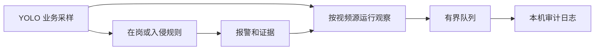

# YOLO 模型安全观察报告

本次增量为真实 YOLO11n 人员在岗监测和人员区域入侵监测增加了安全观察模式。它沿用已发布的业务规则产生报警，同时独立记录采样、检测结果和报警证据的异常。操作员可以借助这些记录定位需要回看的视频源和时段。观察模式默认关闭。

## 一、实现机制



执行器在业务采样点复用本次推理的检测框、置信度和区域内人数。每路视频运行有独立的观察窗口。同一通道内的视频源可共用检测规则，各自累计观察记录。[监测接入](../backend/app/modules/local_execution/service.py) · [观察窗口](../backend/app/modules/local_execution/safety_signals.py)

| 检查项 | 判定与记录 | 用途 |
| --- | --- | --- |
| 采样连续性 | 时间无效、重复、回退或间隔超过规则允许范围时记录异常。读流或执行中断时记录中断，并重置窗口。 | 区分画面持续可用的观察与存在缺口的观察，定位异常时段。 |
| 检测稳定性 | 在最近最多六个业务采样点内，区域人数是否达标至少变化三次，且至少两次达标依赖置信度位于检测阈值至阈值加 0.05 的框时，记录 `unstable_detection`。 | 标记人员反复消失和重现的片段，便于回查遮挡、画面质量和检测波动。 |
| 报警证据 | 报警持久化后，核对任务、版本、通道、视频源、运行标识，检查录像事件时间是否落在所选区间，并确认至少一项证据已就绪。 | 按报警 ID 定位证据缺失、关联不一致或时间范围异常。 |

审计写入由后台线程处理。同一运行的同类异常每 10 秒最多记录一次，时间间隔按运行机器的单调时钟计量。队列上限为 128 条，队列满时丢弃新增审计，后续成功写入时通过 `dropped_since_write` 汇总数量。单份日志约 5 MiB，额外保留两份轮转文件。关闭时最多等待约 0.5 秒，超时后放弃积压，已经开始的写入可结束。

安全检查出错时，该路观察停用并尝试记录 `observer_failed`。日志写入失败时，后台写入停用并在服务日志中记录失败提示。安全记录仅包含必要的标识、时间和诊断字段，报警和任务状态继续由原业务流程负责。[运行级审计](../backend/app/modules/local_execution/run_safety_audit.py) · [后台写入](../backend/app/modules/local_execution/safety_audit.py)

## 二、对系统的作用

- **定位异常来源。** 缺岗发生前若有采样间断或检测波动，可按视频源和时间段核查现场，减少逐路回看录像的范围。
- **追溯报警证据。** 截图生成失败或事件关联异常时，通过同一条审计记录找到对应任务、运行和报警。
- **约束审计开销。** 各路观察独立限频，后台队列和文件轮转控制内存及磁盘使用。现场监测流程无需等待日志落盘。

当前信号用于排查证据质量。遮挡、人员真实进出和传输故障也可能造成异常表现，是否存在攻击需要结合原始视频和现场上下文判断。证据核对覆盖生成状态与关联字段。该增量的验收范围是本地 YOLO 观察和业务回归。

## 三、系统内使用指南

### 1. 开启观察

1. 在实际启动的工作台项目目录中更新 `main`。当前已在 `main` 的 Git 克隆可运行 `git pull --ff-only origin main`。在**同一个目录**打开或新建文件 `.env.local`，保留已有配置，并添加下面一行。

   ```dotenv
   VISION_MODEL_SAFETY_OBSERVE=true
   ```

2. 停止并重启该工作台，沿用原启动方式和端口。例如，独立的 8002 工作台可以在项目根目录运行 `.\start.cmd --port 8002`。如果启动脚本设置了同名环境变量，以环境变量为准。
3. 在 **运行状态** 查看本地 YOLO 模型是否可执行。初次准备真实模型和模板时，按对应接入说明操作。[人员在岗监测](PRESENCE_MONITORING.md) · [人员区域入侵监测](INTRUSION_MONITORING.md)

### 2. 运行任务

1. 在 **视频源管理** 导入录像并等待就绪，或选用已在线的摄像头。
2. 在 **任务创建** 选择已发布的“人员在岗监测”或“人员区域入侵监测”模板，点击 **确认模板，下一步**。
3. 选择一至多路视频，逐路绘制并保存闭合监测区域。录像还需填写起止时间。点击 **验证任务**，核对配置，勾选确认项后点击 **确认启动**。
4. 在 **智能体管理 → 对应模板 → 关联任务 → 查看画面与报警** 核对业务结果。需要查看单路画面和报警时，点击 **单画面与报警**。[完整任务操作说明](AGENT_TEMPLATES_GUIDE.md)

### 3. 查看和解释记录

出现异常并成功写入后，在数据目录的 `logs/model-safety.jsonl` 查看审计。默认目录为 `var/`，使用 `VISION_VAR_ROOT` 的部署以实际目录为准。可在项目根目录通过 PowerShell 查看最近记录。

```powershell
$log = '.\var\logs\model-safety.jsonl'
if (Test-Path -LiteralPath $log) {
    Get-Content -LiteralPath $log -Encoding UTF8 -Tail 20 |
        ForEach-Object { $_ | ConvertFrom-Json } |
        Format-Table observed_at, source_id, run_id, reason, start_seconds, end_seconds, event_id -AutoSize
}
```

| `reason` | 如何阅读 |
| --- | --- |
| `invalid_sample_time`、`sample_time_not_increasing`、`sample_gap` | 采样时间无效、未递增或出现间隔，按视频源回查对应时段。 |
| `observation_interrupted` | 观察因执行或读流中断而重置，可结合运行状态和 API 日志排查。 |
| `unstable_detection` | 连续多次切换且存在临界置信度检测，优先回看该段画面。 |
| `event_scope_mismatch`、`event_media_range_invalid`、`evidence_unavailable` | 通过 `event_id` 关联原报警，核对配置范围或证据生成状态。 |
| `observer_failed` | 该路观察已停用，结合 API 日志和运行环境排查。 |

`observed_at` 是 UTC 记录时间。`start_seconds` 和 `end_seconds` 对录像表示媒体位置，对直播表示采样时钟上的位置，缺少对应位置时可为空。审计文件在首条记录写入后生成，若暂时查不到文件，可先核对启动目录、开关和真实模型状态，再在 `var/logs/api.log` 检查审计启动或写入告警。

将 `VISION_MODEL_SAFETY_OBSERVE` 改回 `false` 并重启，即可结束观察。已有日志可用于对照排查。

## 四、验收结果

在实现提交 `a0ea596` 上完成了 391 项后端与部署测试、152 项前端测试和生产构建。专项用例覆盖采样间断、检测波动、证据写入失败、多路隔离、队列满载及关闭超时。[实现提交记录](https://github.com/jiacheng299/vision-appliance-software/compare/d532ea1...a0ea596)

用同一段 98 秒录像和本地 YOLO 分别在开启与关闭观察时回放，结果如下。两种模式的事件类型、媒体起止时间和截图 SHA-256 一致。

| 真实模板 | 两种模式共同结果 |
| --- | --- |
| 人员在岗监测 | 缺岗 26–56 秒，恢复在岗 62–92 秒。 |
| 人员区域入侵监测 | 两次入侵，分别为 12–20 秒和 62–70 秒。 |

这次回放验证了同一输入下的报警与截图一致性。长期运行、多路并发的 P95 延迟和对抗样本上的检测效果需要单独测量。
