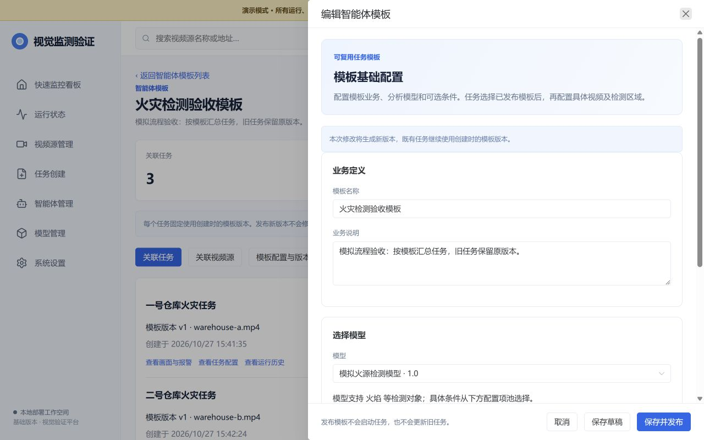
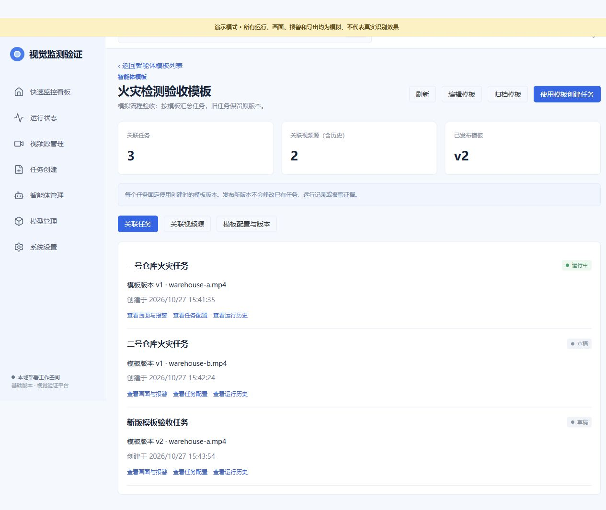

# Issue #7 模板与任务验收记录

日期：2026-10-27。数据库迁移至 `0007_agent_templates`。验收数据为自动生成的纯色测试录像与隔离模拟状态，不含客户视频或真实推理结果。

## 自动验证

| 范围 | 命令 | 结果 |
|---|---|---|
| 后端与部署 | `python -m pytest tests/backend tests/deploy -q` | 149 passed；执行路径保护修复后再次通过 |
| 前端整体回归 | `cd frontend; npm test` | 22 个文件，101 passed |
| 模板参数、任务创建、历史向导 | `npm test -- tests/task-create.test.ts tests/agent-templates.test.ts tests/template-task-create.test.ts` | 28 passed |
| 任务编辑及历史向导 | `npm test -- tests/agents.test.ts tests/task-create.test.ts` | 25 passed |
| 模板接口最终专项 | `python -m pytest tests/backend/test_agent_templates.py -q` | 9 passed |
| 类型与生产包 | `npm run build` | vue-tsc 与 Vite 构建通过 |
| 公共契约 | `python contracts/generate.py`、`npm run generate:api` | 重新生成与已提交定义一致 |

本机测试设置了 `PYTHONPATH=backend;<项目根目录>`、项目内 TEMP/TMP 和 FFmpeg/FFprobe 路径。安装和标准验证命令仍见 README。Vite 保留既有 hls.js 分块大小提示，不影响构建完成。

## 失败到通过的反例

1. 历史编辑入口预先保存一个未完成的创建请求，测试确认入口不能创建脱离模板的新任务。修改前调用了旧创建 API，测试失败；限制兼容模式后不再恢复创建请求，测试通过。
2. 模板任务通过 PATCH 尝试将 `task_mode` 改为 `natural_language`。修改前返回 200，测试失败；新增执行路径约束后返回 422，测试通过。另验证注入其他多模态执行方案同样被拒绝。

其他回归覆盖：旧任务模板版本不变、任务不能换模型/增删配置项/降低必填约束、参数类型与范围、模型声明与执行器支持缺失时阻止执行、请求幂等、归档后旧任务保留、模型引用混合分页、迁移重复运行不重写历史多通道多视频配置。

## 浏览器实际操作

独立端口 8008、独立 `.artifacts/template-preview` 模拟库，未写入 8000 正式库。

1. 新建火灾模板，选择模拟火源模型、置信度项目及必填约束，发布 v1（默认 0.8）。
2. 为两段不同测试录像各创建一个任务。第一个任务验证、确认、异步启动完成，并在任务工作空间显示模拟运行与事件；第二个保存为草稿。
3. 修改模板默认值为 0.9 并发布 v2，再新建一个任务。模板详情显示旧两个任务采用 v1，新任务采用 v2；3 个任务汇总为 2 个去重视频源。
4. 桌面 1280px 下抽屉从 x=560 开始、宽 720px；390px 窄屏下抽屉宽 390px，页面无横向溢出；测试后已恢复默认视口。
5. 浏览器控制台未发现本次流程错误或警告。

## 实际边界

模拟模型声明参数仅用于验证配置传递；不执行火灾检测。真实推理、运行/事件服务与媒体网关接入仍按既有公共端口完成。24 个目录项目不代表全部模型均支持；未声明支持的非空参数不能通过验证。历史多通道模板迁移生成待确认草稿，原任务保持完整。
